I'm a senior at South Brunswick High School in New Jersey. Most of what I build sits somewhere between AI, security and hardware, and a lot of it gets built in 24 hours at hackathons.

Right now I'm:

- an AI engineer on the founding team of [VividSense](https://vividsenselabs.com), a student nonprofit making affordable assistive tech. We've raised $15K, tested with 20+ users, and our prosthetic arm, Dexarm, took 1st of 44 teams at LaunchSB.
- co-CEO of Atmosphere, an AI assistant plugin for Roblox Studio.
- contributing to [Vauxguard](https://zenodo.org/records/22848992), research on zero-shot deepfake voice detection that hit 86% accuracy.

This summer I was an advanced cybersecurity intern at NJCCIC, New Jersey's state cybersecurity agency. Earlier in the year my team placed in the top 2% of the Garden State Cyber CTF.

## Hackathons

I've won prizes at 9 of the 16 hackathons I've entered.

| Project | Award | Event | Built with |
|---|---|---|---|
| [AdaptFit](https://devpost.com/software/adaptfit) | HS Track 1 Prize | PeddieHacks 2026 | React Native, MediaPipe, Fastify |
| [DocLAB](https://devpost.com/software/doclab) | Public Choice | HackJPS 2026 | Rust/Tauri, PyTorch, LoRA, XGBoost |
| [SproutGO](https://devpost.com/software/sproutgo) | Prize winner | MontyHacks IX, 2026 | Next.js, Prisma, PostgreSQL |
| [WearWise](https://devpost.com/software/wearwise-u8632l) | Most Innovative | HackTCNJ 2026 | React, Python, Gemini |
| [Clutch](https://devpost.com/software/clutch-9zq6y1) | Winner | HackSB 2026 | Swift, Firebase |
| [SproutShare](https://devpost.com/software/sproutshare-y04bdm) | 2nd Place, Best .Tech Domain | hackPHS 2025 | Next.js, Supabase, Leaflet |
| [Security SandBox](https://devpost.com/software/project-v2r3j41gmlxo) | Prize winner | MontyHacks VIII, 2025 | TypeScript |
| [VerifAI](https://devpost.com/software/tick-tock-check) | Winner | HackSB 2025 | Python, OpenAI API |
| Diabetes Logger | Winner | BRHS Hackathon 2024 | Python |

The latest one is [GimDrone](https://devpost.com/software/balldrone), a collision-resistant FPV drone for search and rescue, built at hackPHS 2026 with ExpressLRS, EdgeTX and Flutter.

## What I use

Mostly Python, TypeScript, Swift, C++ and Rust. PyTorch for models, React and Next.js for the web, Tauri for desktop, Flutter for mobile, and Arduino/ESP32 when it has to touch the real world.

## Elsewhere

[LinkedIn](https://www.linkedin.com/in/wasim-vorvoi-28870b275/) · [Devpost](https://devpost.com/wasimvorvoi) · [wasimvorvoi.github.io](https://wasimvorvoi.github.io)
